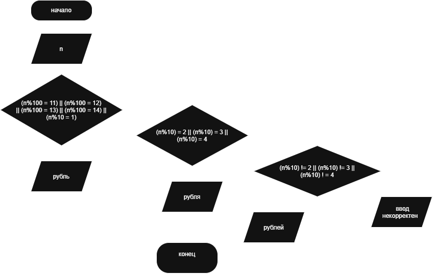

**Условие**
Написать программу, которая вводит число от 1 до 999 и выводит его с правильным словом: «рубль», «рубля» или «рублей».

**Блок схема**

**Контрольный пример**
Ввод: 12
Вывод: 12 рублей

Ввод: 21
Вывод: 21 рубль

Ввод: 2
Вывод: 2 рубля
