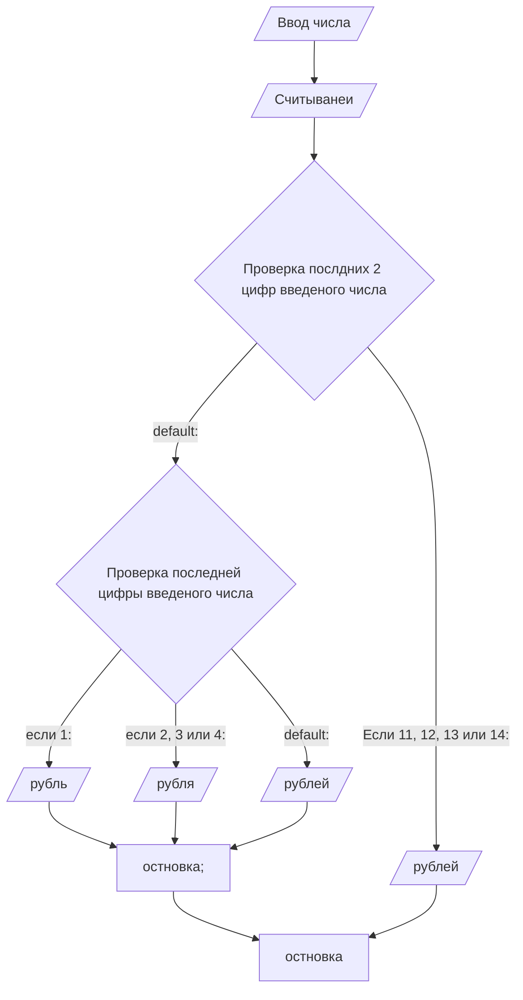

**Условие**
Написать программу, которая после введенного с клавиатуры числа (в
диапазоне от 1 до 999), обозначающего денежную единицу, дописывает
слово “рубль” в правильной форме. Например, 12 рублей, 21 рубль и т.д.

**Блок схема**

**Контрольный пример**
Ввод: 12
Вывод: 12 рублей

Ввод: 21
Вывод: 21 рубль

Ввод: 2
Вывод: 2 рубля
